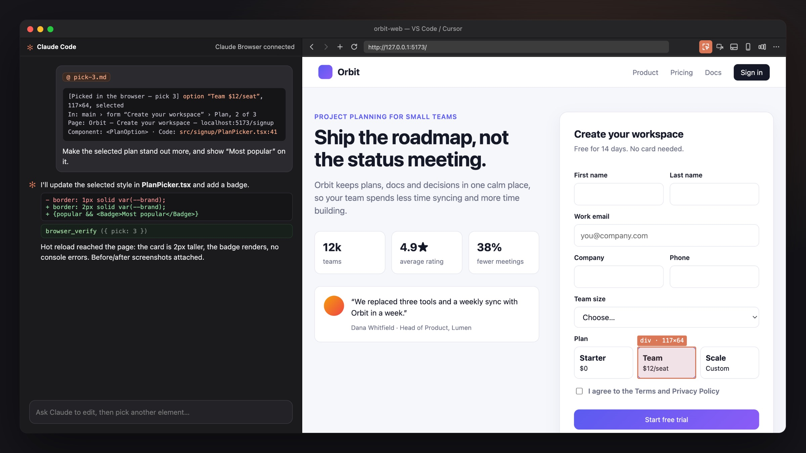
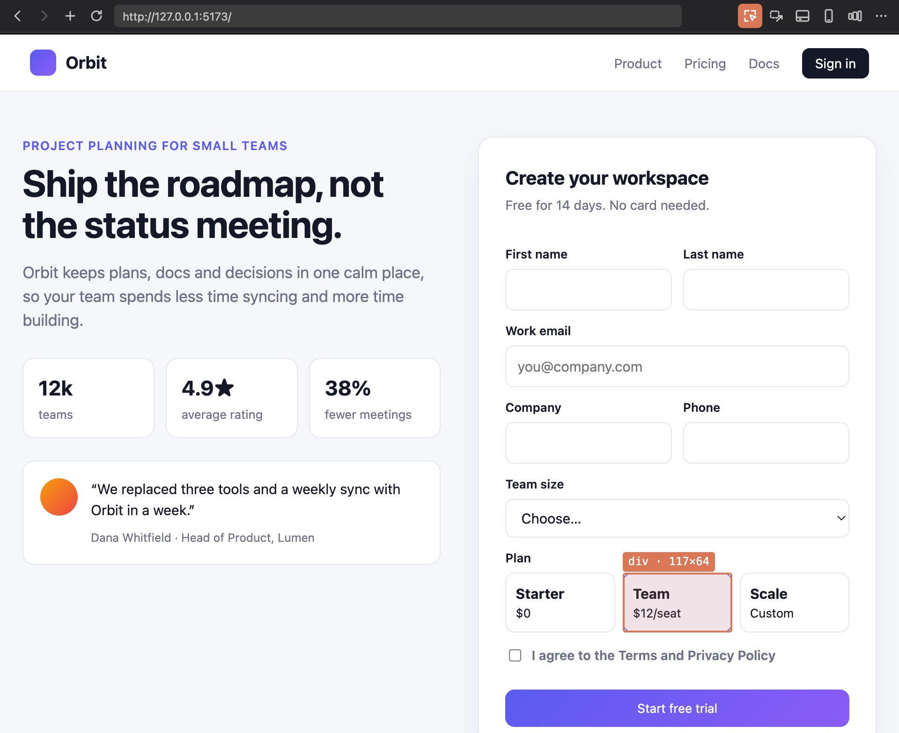
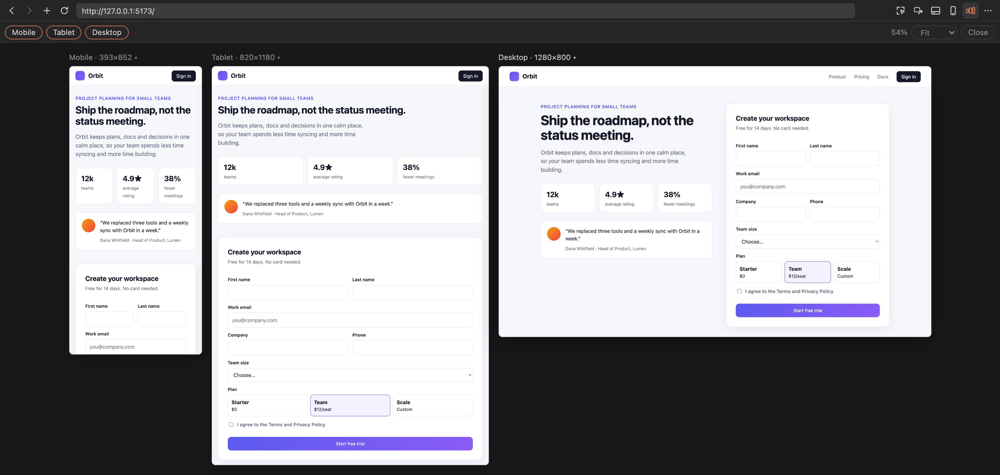
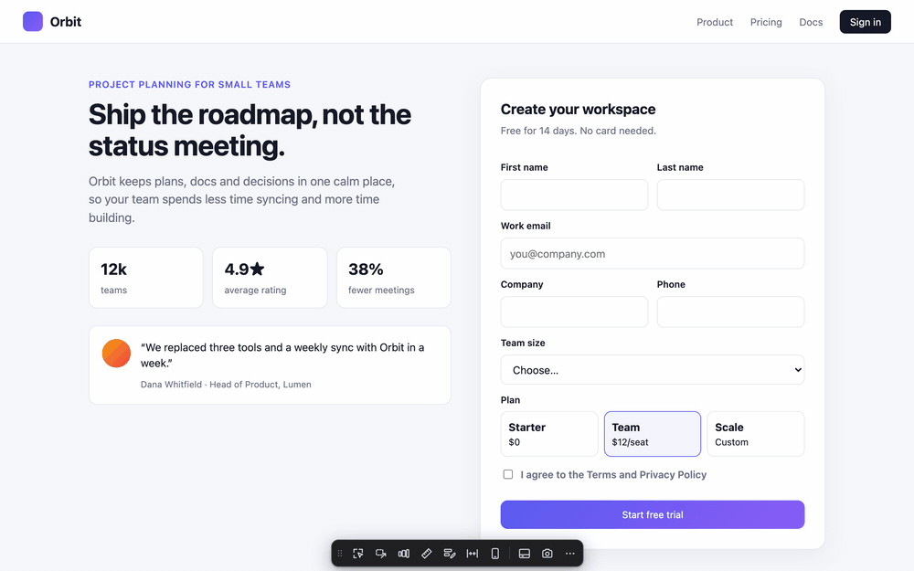
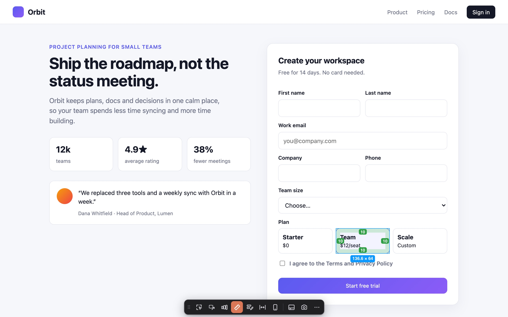
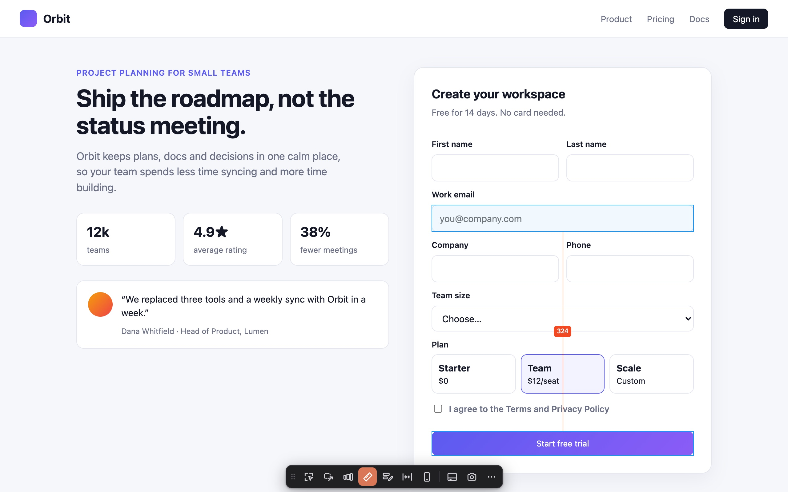
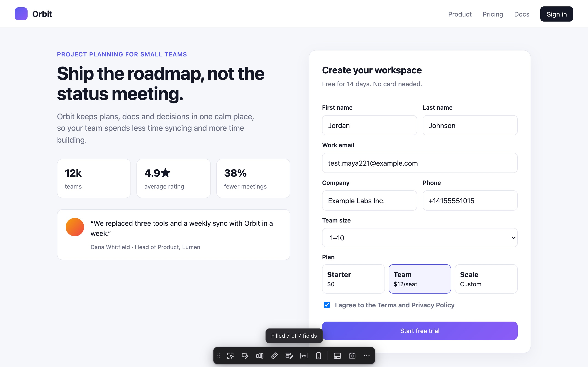
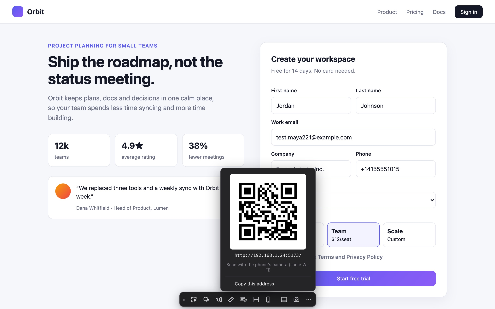

<div align="center">


# Claude Browser

**A live browser inside VS Code and Cursor, shared with Claude Code.**
You and Claude see and drive the same tab. Point at anything on the page, and Claude knows exactly which element and which line of code you mean.

[](https://marketplace.visualstudio.com/items?itemName=anthropic.claude-code)
[](https://code.visualstudio.com/)
[](https://cursor.com/)
[](#-what-claude-can-do-mcp-tools)
[](LICENSE)

[Install](#-install) · [Features](#-features) · [Claude's tools](#-what-claude-can-do-mcp-tools) · [How it works](#-how-it-works) · [FAQ](#-faq) · [Full reference](docs/REFERENCE.md)

<br>



</div>

---

## Why

Claude Code is great at writing frontend code, but it works blind: it can't see what your page looks like, and you end up describing things like *"the second card in the pricing section, the one with the purple border"*.

**Claude Browser fixes that.** It puts a real Chromium tab inside your editor and connects it to Claude Code over MCP:

- 🎯 **Pick an element** and a short card lands in your Claude Code prompt: what it is, where it sits on the page, and the **component and source line** that renders it. About 100 tokens, no screenshot needed.
- 👀 **Claude sees what you see.** It navigates, clicks, types, scrolls, reads the console and network, and screenshots the *same* tab you're looking at. No separate headless browser you can't watch.
- ✅ **Claude checks its own work.** After an edit, `browser_verify` waits for hot reload, then reports what changed in the element (size, styles, text), shows before/after images, and lists new console errors.
- 🧰 **A front-end toolbox** for you too: side-by-side mobile/tablet/desktop, measure spacing, fill forms with valid test data, sweep through screen sizes, open the page on your phone, real Chrome DevTools.

Built for the official **[Claude Code for VS Code](https://marketplace.visualstudio.com/items?itemName=anthropic.claude-code)** extension, in **VS Code** and **Cursor**. Works with any web stack; React gets extra superpowers (component names, props, hooks, source lines).

---

## 🚀 Install

**You need:** VS Code 1.90+ or Cursor, the [Claude Code extension](https://marketplace.visualstudio.com/items?itemName=anthropic.claude-code), and [Node.js](https://nodejs.org/) 18+.

### Option A: let your agent do it

Paste this into Claude Code:

```text
Install the Claude Browser extension for me:
1. Download the latest claude-browser-*.vsix from https://github.com/mahan-sepehri/claude-browser/releases/latest
2. Install it with `cursor --install-extension <file>` if I'm in Cursor, otherwise `code --install-extension <file>`.
3. Register its MCP server with Claude Code at user scope:
   claude mcp add --scope user claude-browser -- node ~/.claude-browser/mcp-server.js
   (that file is created when the extension first starts; if it's missing, ask me to reload the editor window first)
4. Tell me to run "Developer: Reload Window" and start a new Claude Code session.
```

### Option B: by hand

1. **Download** `claude-browser-<version>.vsix` from the [latest release](https://github.com/mahan-sepehri/claude-browser/releases/latest).
2. **Install it:** in the editor, open the Command Palette → **Extensions: Install from VSIX…** and pick the file. Or from a terminal:

   ```bash
   code --install-extension claude-browser-0.31.0.vsix
   ```

   ```bash
   cursor --install-extension claude-browser-0.31.0.vsix
   ```

3. **Connect it to Claude Code:** after a reload, Claude Browser asks *"Register its browser tools with Claude Code?"* → click **Register**. (Or run **Claude Browser: Register MCP Server with Claude Code** from the Command Palette.)
4. **Open it:** <kbd>Ctrl</kbd>+<kbd>⌘</kbd>+<kbd>B</kbd> on macOS, <kbd>Ctrl</kbd>+<kbd>Alt</kbd>+<kbd>B</kbd> on Windows/Linux, or click **🌐 Browser** in the status bar.
5. **Start a new Claude Code session** so it picks up the `browser_*` tools. Try: *"open localhost:3000 and tell me what's broken"*.

> On first start the engine downloads its own Chromium ("Chrome for Testing", about 200 MB, once) into `~/.claude-browser/chromium`. Until then it uses an installed Chrome, Edge or Brave if there is one.

### Option C: from source

```bash
git clone https://github.com/mahan-sepehri/claude-browser.git
cd claude-browser && npm install && ./ship.sh
```

`ship.sh` packages the `.vsix` and installs it into Cursor or VS Code, whichever CLI it finds.

---

## ✨ Features

### 🎯 Pick an element → Claude knows the code

Click the crosshair (or <kbd>⌘</kbd><kbd>⇧</kbd><kbd>C</kbd>) and click anything. A **pick card** is @-mentioned in your Claude Code prompt:

```text
[Picked in the browser — pick 3] option “Team $12/seat”, 117×64, selected
In: main › form “Create your workspace” › Plan, 2 of 3
Page: Orbit — Create your workspace — localhost:5173/signup
Component: <PlanOption> · Code: src/signup/PlanPicker.tsx:41
More only if needed: browser_inspect({pick: 3, aspect: styles|rules|layout|animation|events|html|react|source})
```

Then just say *"make this stand out more"*. Claude edits the right file without searching for it, and fetches styles, CSS rules, layout, event listeners or React props only when the task needs them.



- <kbd>↑</kbd>/<kbd>↓</kbd> widen to the parent / narrow back, <kbd>Shift</kbd>-click keeps picking, <kbd>Esc</kbd> cancels.
- Works on disabled buttons, icons inside buttons, shadow DOM and same-origin iframes. The page never receives the click.
- Source lines come from React's debug info mapped through your dev server's source maps (Vite, webpack, Next.js). No plugin or project setup.
- **Right-click → Send this element to Claude** picks without entering pick mode.

### ✅ Claude verifies its own changes

`browser_verify` closes the loop: it waits for your dev server's hot reload (Vite, webpack, Next.js), lets the page settle, then reports the build error or overlay if there is one, finds the picked element again and diffs its **size, position, text, classes and computed styles**, attaches **before/after** pictures, and lists console errors and failed requests that appeared since the change.

### 📱 Side by side: mobile, tablet, desktop at once

One click shows the page at three sizes, live. Navigation, scrolling and in-app route changes follow the pane you're using; logins are shared. Phone and tablet panes behave like **touch devices** (touch events, `hover: none`, momentum scrolling). Click a pane's label for other devices (iPhone SE, iPad mini, Full HD…) or a custom size.



### 🧰 The in-page toolbar



| Tool | What it does |
|---|---|
| 📏 **Measure** (or hold <kbd>⌥</kbd>) | Hover for size, padding and margin with the px value of every side. Click one element, hover another: distances between them. |
| 📝 **Fill this form** | Fills the form with realistic test data that passes validation: names, emails, phone numbers, IBANs with valid check digits, published test card numbers, postal codes, dates, selects, checkboxes. Also **Fill with long text** (overflow testing) and **Clear**. Works with React-controlled inputs. |
| ↔️ **Sweep sizes** | Animates the page from QHD down through laptops, tablets and phones to 320 px, pausing on each real device size. Finds the breakpoint that breaks. |
| 📲 **Open on my phone** | QR code of the current page with `localhost` swapped for your LAN address, plus a hint if your dev server only listens on localhost. |
| ✏️ **Mark up** (<kbd>⌘</kbd><kbd>⇧</kbd><kbd>S</kbd>) | Draw boxes and arrows on the page, add a note, send it to Claude with the elements under each mark. |
| 🔴 **Errors badge** | Console errors and failed requests, with stacks mapped to your source. Click one to send it to Claude. |
| 🛠 **DevTools** | The real Chrome DevTools for the shared tab. |

<table><tr>
<td></td>
<td></td>
</tr><tr>
<td></td>
<td></td>
</tr></table>

### …and everything you'd expect from a browser

Tabs and popups (OAuth works), address bar with history and inline completion, a start page listing the dev servers running on your machine, downloads, file uploads, camera and microphone, light/dark `prefers-color-scheme`, zoom, hard reload, clear site data, native-looking `<select>`/date/color pickers, and logins that persist across restarts. If the page hangs or Chrome crashes, the engine restarts it and reopens your tabs.

See the **[full reference](docs/REFERENCE.md)** for every detail.

---

## 🤖 What Claude can do (MCP tools)

Once registered, every Claude Code session gets these tools, all acting on the tab you're watching:

| Tool | Purpose |
|---|---|
| `browser_navigate` · `browser_tabs` | Go to a URL, back/forward/reload; list, open, switch and close tabs |
| `browser_snapshot` | Accessibility tree of the page with `ref`s to act on (cheap, text only) |
| `browser_screenshot` | Screenshot of the page, an element, or all device sizes at once (`viewports: true`) |
| `browser_click` · `browser_type` · `browser_press` · `browser_hover` · `browser_scroll` · `browser_select` · `browser_upload` | Interact like a user |
| `browser_wait` | Wait for text, a selector, or the network to go idle |
| `browser_evaluate` | Run JavaScript in the page |
| `browser_console` | Console messages and exceptions, stacks mapped to source |
| `browser_network` | Requests the page made, filterable; full headers, bodies and timing for one (secrets masked) |
| `browser_picked` | What you picked, marked up or sent from the browser |
| `browser_inspect` | Details of a pick: `styles`, `rules`, `layout`, `animation`, `events`, `html`, `react`, `source` |
| `browser_react` | React component, props, hooks and context for an element or a component by name |
| `browser_verify` | Check a code change after hot reload: element diff, before/after, new errors |
| `browser_viewport` | Fixed device size, custom sizes, or the side-by-side view |
| `browser_downloads` | Files the page downloaded |
| `browser_status` · `browser_restart` | Engine health; restart the browser and reopen tabs |

**Example prompts**

- *"Open localhost:5173, sign up with test data and tell me if anything errors."*
- *"This button (pick) overflows on mobile. Fix it and verify on all three sizes."*
- *"Why is this request failing? Check the network tab."*
- *"Compare the spacing of these two cards and make them consistent."*

---

## 🧩 How it works

```
 VS Code / Cursor panel ──ws──┐
 (more windows / panels) ─ws──┤
                              ├── engine (Node) ── Chromium (its own profile)
 Claude Code ── MCP stdio ────┘   127.0.0.1 only, random token
             (mcp/server.js)
```

- A small **engine** owns one Chromium. The editor panel and Claude Code's MCP server both talk to it, so there's exactly one tab you both drive.
- It starts on demand (from the editor or from Claude's first tool call) and exits after 45 idle minutes. It listens on `127.0.0.1` only and every connection needs the token in `~/.claude-browser/token`.
- The browser has its own profile in `~/.claude-browser/profile`: your logins persist, and your everyday Chrome is never touched.

### Display modes

Set `claudeBrowser.mode`:

| Mode | What you get |
|---|---|
| `panel` *(default)* | Headless Chromium streamed into an editor panel, next to your code. |
| `window` | Chromium as its own native window: always sharp, native popups and DevTools. Picks still go to Claude. The toolbar features above live here. |
| `cursor` | Drives **Cursor's built-in Browser Tab** over CDP. Needs Cursor started with `--remote-debugging-port=9333`; the command **Claude Browser: Restart Cursor with Browser Control** does that for you (macOS). |

### Settings

| Setting | Default | |
|---|---|---|
| `claudeBrowser.mode` | `panel` | `panel`, `window` or `cursor` (above) |
| `claudeBrowser.homeUrl` | *(start page)* | URL to open when nothing is restored |
| `claudeBrowser.onPick` | `mention` | Put the pick card in the prompt, copy it, or both |
| `claudeBrowser.browser` | `auto` | `auto` downloads its own Chromium; `system` uses installed Chrome/Edge/Brave |
| `claudeBrowser.chromePath` | | A specific Chromium-based executable |
| `claudeBrowser.port` | `47321` | Local engine port |
| `claudeBrowser.nodePath` | *(auto)* | Node.js used for the engine |

### Commands

**Claude Browser: Open** · **Pick Element** · **Side by Side** · **Restart Browser Engine** · **Register MCP Server with Claude Code** · **Restart Cursor with Browser Control**

---

## ❓ FAQ

<details>
<summary><b>Does this work with the Claude Code CLI in a terminal?</b></summary>

Yes. The MCP tools work in any Claude Code session that has the server registered (it's user scope, so every project). Picks are delivered into the prompt of the Claude Code **VS Code extension**; from the CLI, ask Claude to call `browser_picked`, or set `claudeBrowser.onPick` to `clipboard` and paste.
</details>

<details>
<summary><b>How is this different from Playwright MCP or Cursor's browser?</b></summary>

Playwright-style MCP servers drive a browser you usually don't watch, and you can't point at things. Claude Browser is one tab that you and Claude share: you see every action live, you can take over at any moment, and picking an element hands Claude the component and source line directly. It also has front-end tools (verify after hot reload, React inspector, network bodies, side-by-side devices) tuned for the edit → check loop.
</details>

<details>
<summary><b>Which platforms are supported?</b></summary>

macOS is the main, best-tested platform. Windows and Linux are supported by the engine and panel mode; `window` mode and the Cursor restart command are tested on macOS only. Reports and fixes are welcome.
</details>

<details>
<summary><b>Is anything sent anywhere?</b></summary>

No. Everything runs locally: the engine binds to `127.0.0.1` with a token, and pages only go where you (or Claude) navigate. The only download is the one-time Chromium build from Google's Chrome for Testing storage.
</details>

<details>
<summary><b>Claude doesn't see the browser tools.</b></summary>

Start a *new* Claude Code session after registering. Check with `claude mcp list` that `claude-browser` is listed; if not, run **Claude Browser: Register MCP Server with Claude Code**. Engine logs are in `~/.claude-browser/engine.log`.
</details>

<details>
<summary><b>Is it safe to browse anything in it?</b></summary>

Treat it as a development browser, not a hardened one: Claude can run JavaScript in the page and read its network traffic. Use it for your apps and docs, not your bank.
</details>

---

## 🤝 Contributing

Issues and pull requests are welcome. The code is plain JavaScript with no build step:

| Path | What |
|---|---|
| `extension.js` | Editor side: panel, picks → Claude Code prompt, MCP registration |
| `daemon/daemon.js` | The engine: Chromium, tabs, streaming, every tool |
| `daemon/inpage.js` · `daemon/ui.js` · `daemon/fill.js` | Scripts injected into pages: picking, React inspection, toolbar, form filler |
| `mcp/server.js` | MCP server that forwards Claude's tool calls to the engine |
| `media/` | The panel UI |

See [docs/REFERENCE.md](docs/REFERENCE.md#build-from-source) for running a separate test engine while you hack on it.

## License

[MIT](LICENSE). Not affiliated with or endorsed by Anthropic; "Claude" and "Claude Code" are Anthropic's trademarks, used here to say what this works with.
